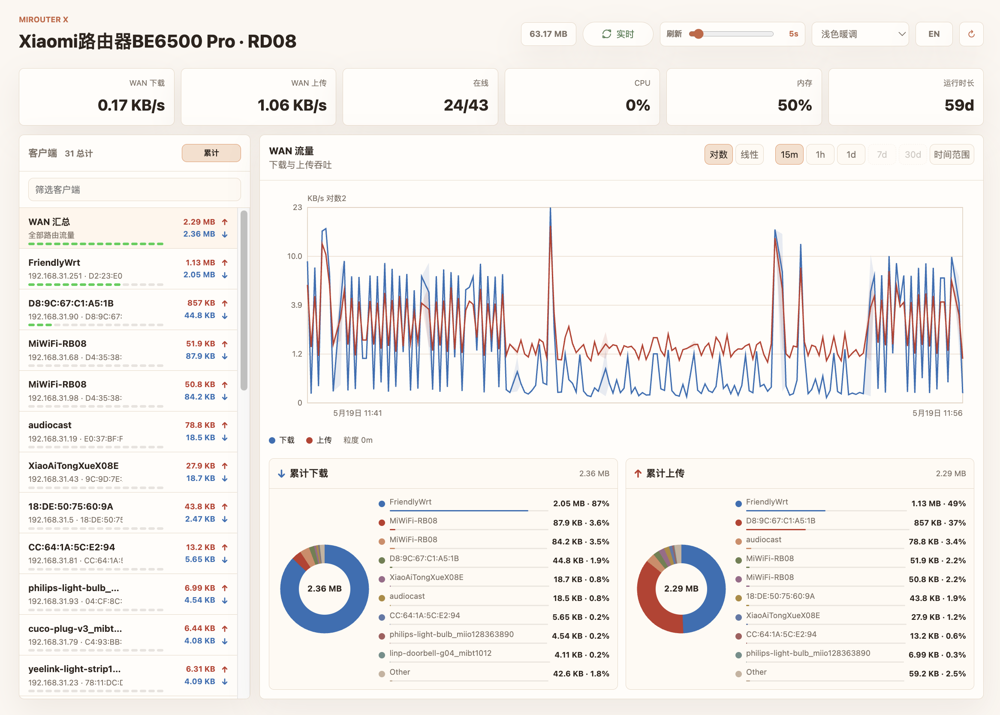

# Mirouter X

一个本地运行的小米路由器仪表盘，支持 SQLite 历史数据和高性能 canvas 图表。



## 运行

```sh
cp .env.example .env
# 编辑 .env 并设置 MIROUTER_PASSWORD
npm run serve
```

使用示例 `.env` 时，打开 `http://127.0.0.1:3000`；也可以设置 `PORT` 使用其他端口。没有 `.env` 时，应用会回退到端口 `3102`。

## Docker

```sh
cp .env.example .env
# 编辑 .env 并设置 MIROUTER_PASSWORD
docker compose up --build -d
```

使用示例 `.env` 时，打开 `http://127.0.0.1:3000`；也可以设置 `PORT` 使用其他端口。没有 `.env` 时，Compose 会回退到端口 `3102`。

Compose 文件会把 SQLite 数据存放在主机的 `./data` 目录。若要直接运行预构建镜像，请挂载 `/app/data` 并映射端口 `3102`：

```sh
docker build -t mirouter-x .
docker run -d --name mirouter-x \
  --env-file .env \
  -e HOST=0.0.0.0 \
  -e MIROUTER_DB=/app/data/mirouter.sqlite \
  -p 3102:3102 \
  -v "$PWD/data:/app/data" \
  mirouter-x
```

## 配置

| 变量 | 默认值 | 说明 |
|---|---|---|
| `MIROUTER_HOST` | `192.168.31.1` | 路由器 IP 地址 |
| `MIROUTER_PASSWORD` | - | 路由器管理密码（必填） |
| `MIROUTER_NONCE_DEVICE_ID` | auto | 适配不同固件登录哈希的设备 ID |
| `MIROUTER_AUTH_KEY` | MiWiFi default | 适配不同固件登录哈希的密钥 |
| `MIROUTER_POLL_SECONDS` | `30` | 采集间隔，单位秒（最小 1） |
| `MIROUTER_FLUSH_SECONDS` | `15` | 采样数据批量写入 SQLite 的间隔，单位秒；增大可显著降低磁盘写入量，最新状态、客户端和原始图表从内存缓冲读取，不受落盘周期影响；异常断电可能丢失一个落盘周期内的数据 |
| `MIROUTER_ROLLUP_SECONDS` | `60` | 1 分钟聚合任务（rollup）的运行间隔，单位秒（最小 60）；增大可降低磁盘写入量，代价是使用 1m 层级的视图（如 1d）尾部最多滞后一个聚合周期 |
| `MIROUTER_TOKEN` | - | 可选访问令牌；设置后所有 `/api/*` 请求（`/api/health` 除外）需携带 `Authorization: Bearer <token>` 头或 `?token=<token>` 查询参数 |
| `MIROUTER_RETENTION_DET_DAYS` | `7` | 原始数据和 1 分钟汇总数据的保留天数 |
| `MIROUTER_RETENTION_AGG_DAYS` | `365` | 1 小时和 1 天汇总数据的保留天数 |
| `MIROUTER_LOG_SUMMARY_MINUTES` | `10` | API 调用摘要日志间隔；设为 `0` 可禁用 |
| `PORT` | `3102` | HTTP 监听端口 |
| `HOST` | `127.0.0.1` | HTTP 绑定地址（Docker 使用 `0.0.0.0`） |
| `MIROUTER_DB` | `./data/mirouter.sqlite` | SQLite 数据库路径 |

- `MIROUTER_PASSWORD` 必填。应用启动时会登录小米路由器，以获取并刷新会话 token。
- `MIROUTER_NONCE_DEVICE_ID` 和 `MIROUTER_AUTH_KEY` 用于适配不同固件的登录哈希；默认值匹配当前 MiWiFi 认证流程，未设置设备 ID 时会自动生成。
- 应用会刻意避免持久化敏感路由器接口返回的 Wi-Fi 密码。

## HTTP API

除页面本身外，还有两个面向前端的实时/统计端点：

- `GET /api/events`：SSE（`text/event-stream`）实时推送。连接后立即下发一条 `snapshot` 事件，之后每次采集结束（无论成败）都会广播最新快照，数据结构与 `GET /api/summary` 一致；每 25 秒发送一次心跳。EventSource 无法自定义请求头，设置 `MIROUTER_TOKEN` 后请使用 `?token=` 查询参数连接。
- `GET /api/monthly?month=YYYY-MM`：按月流量统计，`month` 省略时为当前月，月份和天均按 UTC 划分。已完成的天来自 1 天汇总表，当月当天用 1 小时汇总即时补齐；响应包含月度总量、逐天字节数和按设备聚合的字节排行。月份格式非法时返回 400。

1 分钟汇总的字节数优先由 WAN 累计计数器的差值得出（比按平均速率估算更准）；当分钟内计数器未增长或路由器重启导致计数器归零时，回退到平均速率 × 60 秒的估算。

## 图表时间范围

仪表盘提供预设时间范围，也支持完整的自定义时间范围选择。后台汇总任务会每分钟把原始采样聚合到预计算表中，供较长时间范围查询使用。

### 预设范围

| 范围 | 数据层级 | 桶大小 | 启用所需最少点数 |
|---|---|---|---|
| 15m | 原始采样 | 每次轮询 | 始终启用 |
| 1h | 1 分钟汇总 | 1 分钟 | 30 |
| 1d | 1 分钟汇总 | 1 分钟 | 30 |
| 7d | 1 小时汇总 | 1 小时 | 24 |
| 30d | 1 天汇总 | 1 天 | 15 |

尚未积累足够数据的预设按钮会被禁用，并通过 tooltip 显示当前点数和所需点数。

### 层级回退

如果某个时间范围的自然汇总层级少于 10 个数据点，查询会自动回退到更细一级的数据层级，并重新聚合到期望的桶大小。回退链路为：`1d -> 1h -> 1m`。聚合时会对平均值取 AVG、最小值取 MIN、最大值取 MAX、字节数取 SUM，因此阴影形式的 min/max 区间和总量仍然准确。

### 自定义范围和缩放

- 在图表 canvas 上从左到右**拖拽**，可以放大到对应的精确时间窗口。可重复拖拽继续放大。
- 处于缩放图表视图时，工具栏会显示 **Reset** 按钮。它会恢复原始范围并清除缩放历史。
- **Time range** 预设按钮会打开日期/时间选择器，用于选择任意固定窗口。应用手动范围会清除缩放历史。

### 固定范围模式

自定义范围生效后，仪表盘会进入固定范围模式：

- 图表和客户端用量数据会固定在所选时间段内，不会随自动刷新更新（只有顶部实时统计卡片会刷新）。
- 客户端列表顺序和累计用量反映所选时间段，且不会变化。
- Latest / Accumulated 切换会被禁用；客户端列表始终显示该固定时间段内的累计用量。
- 如果所选窗口早于 `MIROUTER_RETENTION_DET_DAYS`，且落在原始数据或 1 分钟层级内，图表会显示提示，说明明细数据已被清理。

## 数据保留

Mirouter X 使用不同的保留窗口保存两类数据：

- **明细数据**：原始采样（`samples`、`client_samples`）和 1 分钟汇总。按 `MIROUTER_RETENTION_DET_DAYS` 保留（默认 7 天）。如果缩放到早于此限制的原始数据或 1 分钟层级窗口，将不会显示数据；图表会显示一条消息说明当前保留设置。
- **聚合数据**：1 小时和 1 天汇总。按 `MIROUTER_RETENTION_AGG_DAYS` 保留（默认 365 天）。即使明细数据已被清理，较长视图（7d、30d）仍可在完整聚合保留窗口内正常工作。

## 数据库和性能

Mirouter X 每次轮询会在 `samples` 中写入一条路由器数据，并在 `client_samples` 中为每个可见设备写入一条数据。实时采样先写入 SQLite 的内存 TEMP 表，最新状态、客户端、原始图表和短期用量查询合并读取内存与历史数据。批量落盘后清理内存历史，仅保留各设备的最新记录。聚合前强制落盘，防止聚合进度越过未写入的采样。

SQLite 以 WAL 模式运行，并使用 `synchronous=NORMAL`，因此短写入成本较低；但高频采集会让数据库按线性速度增长：

```text
每日客户端采样行数 = 86400 / MIROUTER_POLL_SECONDS * 设备数量
```

当 `MIROUTER_POLL_SECONDS=1` 且有 500 台设备时，每天会产生 4320 万条客户端记录。本项目的本地合成基准测试在桌面 Mac 上写入了 900,000 条客户端记录，相当于 500 台设备运行 30 分钟，耗时约 11 秒，并使用约 109 MiB SQLite 页面。按此推算，在文件系统和 vacuum 影响之前，原始存储量约为 5 GB/天。

后台汇总任务按 `MIROUTER_ROLLUP_SECONDS` 间隔运行（默认每分钟一次），把秒级原始采样压缩到 `samples_1m`、`samples_1h`、`samples_1d`（以及对应的 `client_samples_*` 表）中；间隔拉长时每次运行会批量补跑累积的分钟桶。较长图表视图会查询这些紧凑表，而不是原始采样表，使查询时间与桶数量成正比，而不是与采集行数成正比。

## 磁盘写入量

SQLite 的 WAL 模式按 4 KiB 页写入：每次提交事务时，所有被改动的页（哪怕只改了其中一行）都会整页追加到 WAL，checkpoint 时再整页写回主库文件。因此**磁盘写入量主要由提交频率决定，而不是数据行数**——5 秒采集 + 26 台设备时，实测容器写盘约 2.5 GB/天。

降低写入量的手段（按效果排序）：

- **增大 `MIROUTER_FLUSH_SECONDS`**（默认 15）：采样先进入内存队列，按此间隔合并成一次事务批量落盘。同一批设备页在一个周期内只写一次，写入量近似与落盘频率成反比。例如 5 秒采集时设为 30，写盘量约降为原来的 1/3～1/6。
- **增大 `MIROUTER_ROLLUP_SECONDS`**（默认 60）：1 分钟聚合任务的运行间隔。聚合 SQL 按区间批量处理，间隔改为 300 时每批补跑 5 个分钟桶，聚合写入量近似按频率反比下降。
- **增大 `MIROUTER_POLL_SECONDS`**：直接减少采样行数和提交次数，但图表原始分辨率也随之下降。
- 路由器状态快照（`last_snapshot`）最多每分钟持久化一次，不再每次落盘都重写。
- Docker 部署已在 compose 中限制 json-file 日志大小（10 MB × 3），避免日志无限增长。

本次 SD 卡部署使用 5 秒采集、300 秒落盘、300 秒聚合，每小时 checkpoint。实时状态和 15m 原始图表仍按采集更新；长时间范围聚合最多滞后约 5 分钟。关闭自动 checkpoint，避免频繁重写主库。Docker 直接运行 Node，正常停止时会落盘并 checkpoint。

Raspberry Pi 使用建议：

- 如果数据库放在质量较好的 SSD 上，Pi 通常可以承受 1 秒轮询和 500 台设备的写入速率。
- 不建议在这种负载下使用 microSD 卡，因为写入量大，且会影响长期寿命。
- 在 Raspberry Pi 上使用时，如果需要长时间保留数据，建议使用默认的 30 秒轮询；如果使用 1 秒轮询，请缩短保留时间。例如，1 秒轮询加 500 台设备适合短时间诊断，不适合在 Pi 存储上保存一整年的历史。
- 在默认的 7 天明细保留和 365 天聚合保留下，Pi 上的数据库大小仍可管理：每小时按 7 天窗口清理明细，长期累积的只有紧凑的小时/天汇总数据。
